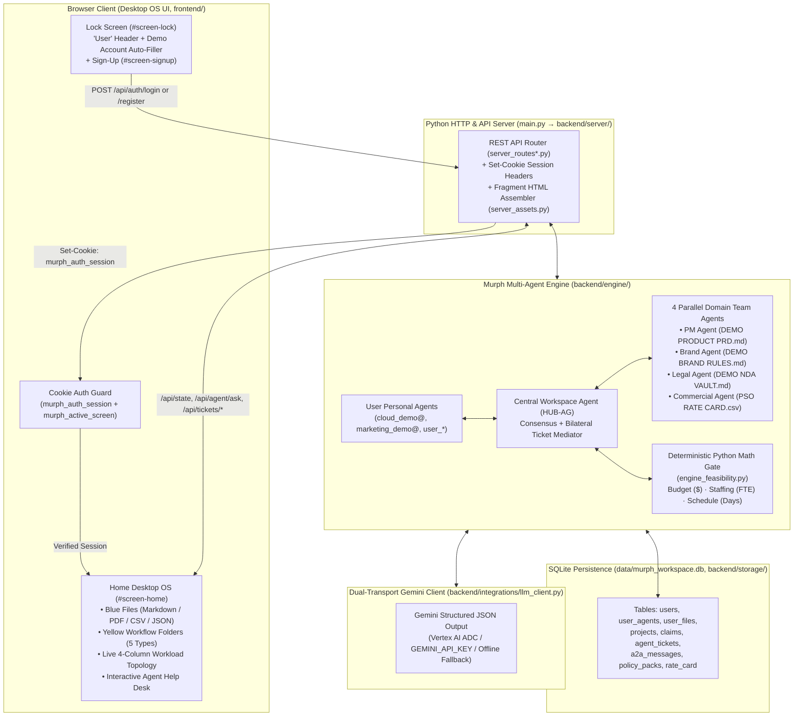
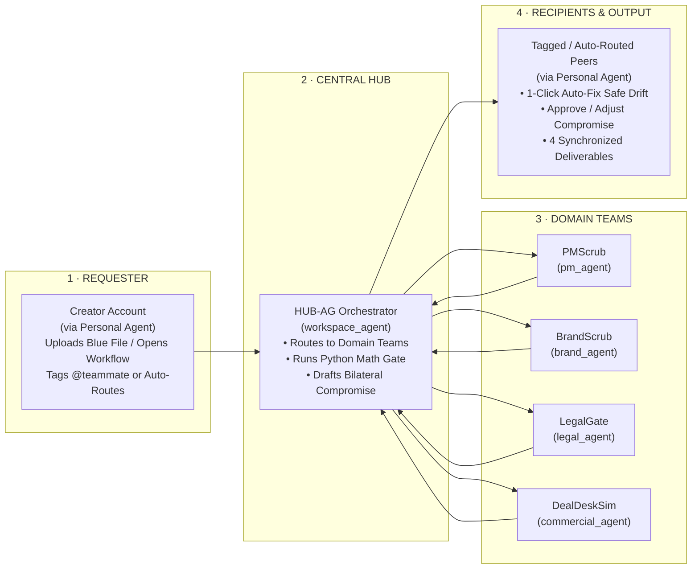

# Murph — Multi-Agent Unified Resource & Project Harmonizer

**Murph** is an interactive, desktop-style multi-agent workspace that eliminates cross-team launch review "fake work" — approval ping-pong, manual claim fact-checking, and spreadsheet budget/staffing recalculations across Product, Brand, Legal, and Commercial teams.

Instead of manual back-and-forth reviews, each user's **Personal Agent** collaborates with a **Central Workspace Agent (`HUB-AG`)** and **4 Domain Team Agents** over shared files:
- **Safe wording drift** is rewritten automatically in one click.
- **Budget (`$`), staffing (`FTE`), and schedule (`days`) math** is computed deterministically in Python — never guessed by an LLM.
- **True hard stops** (such as NDA customer leaks or budget cap overruns) become **Bilateral Shared-File Tickets** with an AI-drafted compromise that humans approve or adjust in one click.

---

## How to Run It

### 1. Start the Server
From the `murph` directory (the folder that contains `main.py`), run:

```bash
python3 main.py --port 8088
```

Then open **`http://localhost:8088`** in your browser (locally the server also listens on mirror ports `8080` and `8788` when available).

| Option | Default | Purpose |
| :--- | :--- | :--- |
| `--port` | `$PORT`, else `8080` | Main HTTP port. |
| `--host` | `::` (dual-stack IPv6 + IPv4) | Interface to bind. |
| `--no-mirrors` | off | Listen on `--port` only. Mirrors are always off when `$PORT` is set (Cloud Run). |
| `MURPH_DB_PATH` | `data/murph_workspace.db` | SQLite file (`:memory:` for a throwaway run). A legacy `murph_workspace.db` in the project root is still used when `data/` has none. |
| `GEMINI_API_KEY` | unset | Enables live Gemini (see step 3). |

The only runtime requirement is **Python 3.10+** (standard library only). `pip install -r requirements.txt` adds the optional `google-genai` SDK transport; without it Murph uses its built-in REST transport.

### 2. Sign In on the Lock Screen
The **Home Workspace (`#screen-home`)** is protected by cookie-based authentication (`murph_auth_session`). Unauthenticated visits to `/home` or the Home OS button automatically redirect to the **Lock Screen** (`#screen-lock`).

On the Lock Screen, use the **Demo Account Auto-Filler dropdown** directly under **`User`** (or type credentials manually):

| Account Type | Email / Username | Password | Default Desktop Items |
| :--- | :--- | :--- | :--- |
| **Cloud Demo (`cloud`)** | `cloud_demo@google.com` | `P@ssword_123` | **Blue Files:** `DEMO PRODUCT PRD.md`, `DEMO NDA VAULT.md`<br>**Yellow Workflows:** `DEMO CLAIM FIX`, `DEMO DELIVERABLES` |
| **Marketing Demo (`dm`)** | `marketing_demo@google.com` | `P@ssword_123` | **Blue Files:** `DEMO BRAND RULES.md`, `DEMO LAUNCH BRIEF.md`<br>**Yellow Workflows:** `DEMO CLAIM FIX`, `DEMO BLOCKERS` |
| **Self-Registered (`user_<slug>`)** | Created via **Sign-Up** (`➕ Create Account`) | Your chosen password | Isolated desktop with its own Personal Agent, private Blue files, and custom workflows |

> **Note:** Only the two built-in demo accounts (`P@ssword_123`, stored in SQLite) and self-registered Sign-Up accounts can log in. Arbitrary unregistered emails or empty passwords are rejected.

### 3. Enable Live Gemini AI (Optional — 3 Ways)
Murph works out of the box in **deterministic fallback mode** with zero configuration. To enable **Live Gemini AI** for the Agent Help Desk, parallel claim scrubbing, and multi-agent ticket negotiation, use any of these options:

1. **Google Cloud Vertex AI (Automatic)**: locally through your `gcloud` login / ADC file; on Cloud Run through the service's runtime service account (see [Deploy to Google Cloud Run](#deploy-to-google-cloud-run)):
   ```bash
   gcloud auth application-default login
   python3 main.py --port 8088
   ```
2. **Gemini API Key via Environment Variable** (or a `GEMINI_API_KEY=...` line in a git-ignored `.env` file next to `main.py`):
   ```bash
   export GEMINI_API_KEY="your-api-key"
   python3 main.py --port 8088
   ```
3. **In-App Help Desk Command (Saved to SQLite)**:
   Inside the Home desktop **Agent Help Desk** terminal, run:
   ```text
   /key YOUR_GEMINI_API_KEY
   ```

### 4. Run the Unit Tests
Run all **38 unit tests** across the four test suites (from the `murph` directory):

```bash
python3 -m unittest discover -s tests -p '*_test.py' -v
```

---

## Deploy to Google Cloud Run

Murph ships as one container: [`Dockerfile`](Dockerfile) (Python 3.13 slim, non-root user, listens on `$PORT`). Cloud Build builds it from source, so you do **not** need Docker locally.

### Option A — One command (Cloud Shell or any machine with `gcloud`)

```bash
cd murph                                   # the folder that contains main.py and Dockerfile
gcloud auth login
deploy/deploy_cloud_run.sh YOUR_PROJECT_ID asia-southeast1
```

The script enables the Cloud Run, Cloud Build, Artifact Registry, IAM and Vertex AI APIs, creates a dedicated runtime service account `murph-runtime@YOUR_PROJECT_ID.iam.gserviceaccount.com` with `roles/aiplatform.user` (live Gemini through Vertex AI, no API key needed), runs `gcloud run deploy --source .` and prints the service URL. Tune it with environment variables:

| Variable | Default | Effect |
| :--- | :--- | :--- |
| `SERVICE` | `murph` | Cloud Run service name. |
| `PUBLIC` | `true` | `true`: anyone with the URL can open Murph (`--no-invoker-iam-check`, which also works in orgs that block `allUsers`). `false`: callers need `roles/run.invoker`; open it with `gcloud run services proxy murph --region REGION`. |
| `VERTEX` | `true` | `true`: live Gemini through Vertex AI as the runtime service account (grants it `roles/aiplatform.user`). `false`: no Vertex AI access. |
| `GEMINI_SECRET` | unset | Name of a Secret Manager secret holding a Gemini API key; mounted as `GEMINI_API_KEY`. A key takes precedence over Vertex AI. |
| `MIN_INSTANCES` | `0` | `1` keeps one instance (and its demo state) warm, at the cost of always-on billing. |
| `RUNTIME_SA` | `murph-runtime@PROJECT_ID` (created if missing) | Runtime service account; it receives the Vertex AI role and access to `GEMINI_SECRET`. |

Live Gemini is on by default (Vertex AI). To use a Gemini API key instead, store it once and pass the secret name:

```bash
printf '%s' "your-api-key" | gcloud secrets create gemini-api-key --data-file=- --project YOUR_PROJECT_ID
GEMINI_SECRET=gemini-api-key deploy/deploy_cloud_run.sh YOUR_PROJECT_ID asia-southeast1
```

### Option B — Google Cloud console (continuous deployment from GitHub)

1. Push this folder to GitHub so that `main.py` and `Dockerfile` sit at the repository root.
2. Open **Cloud Run → Deploy container → Service** and choose **Continuously deploy from a repository**.
3. Click **Set up with Cloud Build**, connect **GitHub**, pick the repository and branch `^main$`, set **Build type** to **Dockerfile** with source location `/Dockerfile`, then **Save**.
4. **Authentication:** choose **Allow public access** (see *Troubleshooting* if your organization blocks it).
5. **Containers, Volumes, Networking, Security:** container port `8080`; memory `1 GiB`, CPU `1`; under **Security**, pick a service account that has `roles/aiplatform.user` for live Gemini through Vertex AI, or under **Variables & Secrets** reference your secret as the environment variable `GEMINI_API_KEY`.
6. **Revision scaling:** maximum instances `1` (minimum `0`, or `1` to keep demo state warm). Click **Create**.

Every push to `main` then rebuilds and redeploys automatically.

### Runtime behaviour on Cloud Run

| Topic | Behaviour |
| :--- | :--- |
| **Port** | Cloud Run injects `$PORT`; Murph listens only there (no mirror ports). |
| **Database** | SQLite at `/app/data/murph_workspace.db` inside the container. It is **ephemeral**: a new instance starts from the seeded demo data, and accounts, uploads and `/key` settings disappear when the instance is replaced. |
| **Scaling** | Keep **max instances = 1**. The engine holds the signed-in session and demo state in memory, so a second instance would show different data. |
| **Persistence (optional)** | For durable data, mount a volume (Cloud Storage FUSE or Filestore NFS) and point `MURPH_DB_PATH` at a file on it. Network filesystems give SQLite no reliable locking, so do this only with one instance; otherwise treat the service as a resettable demo. |
| **Gemini** | Live through Vertex AI by default: the app reads an access token for the runtime service account from the Cloud Run metadata server ([`cloud_run_metadata.py`](backend/integrations/cloud_run_metadata.py)), so that account needs `roles/aiplatform.user` (the script grants it). A `GEMINI_API_KEY` (Secret Manager) takes precedence. With neither, Murph runs in deterministic fallback mode. |
| **Google Drive import** | Needs your personal `gcloud` / ADC login (a service account cannot read your Drive), so on Cloud Run it reports Drive as not connected; everything else works. |

### Troubleshooting

| Symptom | Fix |
| :--- | :--- |
| Making the service public fails with *"...do not belong to a permitted customer"* (Domain Restricted Sharing blocks `allUsers`) | Deploy with the script (`PUBLIC=true` uses `--no-invoker-iam-check`) or run `gcloud run services update murph --region REGION --no-invoker-iam-check`. |
| `--source` build fails with a permissions error | Grant the build identity the builder role: `gcloud projects add-iam-policy-binding YOUR_PROJECT_ID --member serviceAccount:PROJECT_NUMBER-compute@developer.gserviceaccount.com --role roles/run.builder`. |
| Creating `murph-runtime` or adding its IAM binding fails | You need Owner, or Service Account Admin plus Project IAM Admin, on the project. Alternatively pass an existing account with `RUNTIME_SA=...`. |
| Live Gemini stays off (`/api/state` shows `llm_status.live_enabled: false`, or `last_error` shows HTTP 403) | Vertex AI: the service must run as the runtime service account, which needs `roles/aiplatform.user`, and `aiplatform.googleapis.com` must be enabled. New grants can take a minute or two to apply. API key: check that the secret is mounted as `GEMINI_API_KEY` and that the runtime service account has `roles/secretmanager.secretAccessor` on it. |
| Data vanished | Expected after a cold start (ephemeral SQLite); see *Persistence* above or set `MIN_INSTANCES=1`. |

---

## System & Multi-Agent Architecture

### 1. End-to-End System Architecture



---

### 2. Agent Workload & Bilateral Routing Pipeline

Every workflow folder and cross-team request follows a **4-Column Routing Topology** (rendered live at the top of every workload window) and a **4-Stage Execution Pipeline**:



#### How the 4 Stages Work
1. **Stage 0 — Trigger & File Grounding (`engine_files.py`, `engine_agents_grounding.py`)**
   - A user uploads or edits a **Blue File** (or launches a **Yellow Workflow**).
   - Files can be toggled between **`Federated Across All Teams`** (shared across the Cloud/DM agent mesh) and **`Private to My Agent`** (restricted to the owner's Personal Agent). Self-registered accounts default to `private`.
2. **Stage 1 — 4 Parallel Domain Workers (`llm_client.py`, `engine_scrub.py`)**
   - Four role agents inspect the document concurrently (`ThreadPoolExecutor`) against their source-of-truth files (`DEMO PRODUCT PRD.md`, `DEMO BRAND RULES.md`, `DEMO NDA VAULT.md`, `PSO RATE CARD.csv`).
3. **Stage 2 — `HUB-AG` Consensus & Deterministic Python Math (`engine_feasibility.py`)**
   - The LLM is never trusted with arithmetic. Python deterministically computes SKU costs (`$`), staffing (`FTE`), and critical-path days against project caps (`$60,000` cap, `4.0 FTE` cap, `18 days`).
   - Findings are split into **`auto_fix`** (safe wording drift) and **`hard_stop`** (NDA or budget/timeline blockers).
4. **Stage 3 — Bilateral Settlement & Deliverables (`engine_tickets_create.py`, `engine_deliverables.py`)**
   - Tagging teammates (`@marketing_demo@google.com`, `@cloud_demo@google.com`, etc.) or letting `HUB-AG` auto-route creates a **Bilateral Ticket** with a concrete compromise proposal.
   - Once approved, Murph compiles **4 synchronized launch deliverables**: `Launch Blog.md`, `Exec Tracker.json`, `Sales FAQ.md`, and a SHA-256 `Audit Receipt.json`.

---

## Key Features at a Glance

| Feature | How to Use It |
| :--- | :--- |
| **Create Workflows & Blue Files** | **Right-click** anywhere on the Home desktop → choose **`New Workflow`** (opens the 5-type Workflow Wizard) or **`New Blue File`** (opens the Drive/Upload window supporting `.md`, `.pdf`, `.csv`, `.json`, `.txt`, images, and Google Drive import). |
| **Federated vs. Private File Scope** | Open any Blue file to preview/edit it and click **`Federated Across All Teams`** or **`Private to My Agent`**. Changes persist immediately to SQLite and update desktop badges. |
| **5 Workflow Types (Yellow Folders)** | **Claim Fixes** (`scrub`), **Cross-Team Agreement** (`tickets`), **Blocker Alerts** (`escalations`), **Policy & Rates Sync** (`policies`), and **Deliverables** (`deliverables`). |
| **Interactive Agent Help Desk** | Multi-turn conversational Gemini console (`MURPH AGENT HELP DESK`) on the Home desktop. Ask questions about your files, blockers, or tickets; click dynamic suggestion chips; or run `/status`, `/scrub`, `/autofix`, `/resolve`, `/files`, `/trash`, `/trace`, `/key`, `/help`. |
| **Switch or Create Accounts** | Click the **User Pill** (top-right sticky bar) to switch between `Cloud User`, `Marketing User`, or any self-registered account, edit User Settings, or click **`➕ Create Account`** / **`Log Out`**. |
| **GUIDE, Onboarding Tour & Trash Bin** | The **7-step Onboarding Tour** launches automatically on first login per server run (and can be replayed via the **`GUIDE`** desktop tile or **`? Tour`**). Drag any tile onto the **Trash Bin** to archive/restore it (only the creator can delete a shared item). |
| **Admin Mode Pill** | Click **`Admin mode`** (bottom-right corner) to jump between screens (`1 · Intro Page`, `2 · Lock Screen`, `3 · Sign-Up`, `4 · Home OS`) or click **`↻ Reset`** to restore seed data. |

---

## Codebase Structure (All Files ≤ 500 Lines)

```text
murph/
├── main.py                 # Launcher: python3 main.py [--port N] [--no-mirrors]
├── requirements.txt        # Optional google-genai SDK (stdlib REST transport otherwise)
├── Dockerfile              # Cloud Run / container image
├── .dockerignore           # Keeps tests, deploy scripts, databases and secrets out of the image
├── .gcloudignore           # Files not uploaded by `gcloud run deploy --source .`
├── .gitignore
├── BUILD                   # Blaze targets (google3 only)
├── backend/                # Python packages
│   ├── paths.py            # Project root, frontend/, data/ and .env locations; DB path resolution
│   ├── server/             # HTTP server, REST routes, asset serving & exports
│   ├── engine/             # PreFlightEngine and its domain mixins
│   ├── storage/            # SQLite persistence, schema & seeding
│   ├── seed/               # Demo personas, files, tickets, policies & rate card
│   └── integrations/       # Gemini client, Help Desk agent, Google Drive ADC
├── frontend/               # Static UI, served under /static/ (index.html also at /)
│   ├── index.html          # App shell; <!-- @fragment --> includes are expanded server-side
│   ├── styles.css          # Imports css/*.css (inlined by the server)
│   ├── fragments/          # 18 HTML fragments
│   ├── css/                # 19 modular stylesheets
│   ├── js/                 # 26 plain-JS modules, loaded in order by index.html
│   └── assets/             # Images and icons
├── tests/                  # 3 unittest suites (33 tests)
├── deploy/
│   └── deploy_cloud_run.sh # One-command Cloud Run deployment
└── data/                   # Runtime SQLite database (created on first run, git-ignored)
```

### Backend (`backend/`)
| Path | Purpose |
| :--- | :--- |
| `main.py` (project root) | Entrypoint; starts `backend/server/server.py`. |
| `paths.py` | Single source of truth for the project layout: `PROJECT_ROOT`, `FRONTEND_DIR`, `DATA_DIR`, `.env`, and `resolve_db_path()` (`$MURPH_DB_PATH` → `data/murph_workspace.db` → legacy root file). |
| `server/server.py`, `server/server_routes.py`, `server/server_routes_governance.py`, `server/server_assets.py` | HTTP server, REST API endpoints, `Set-Cookie` auth headers, recursive HTML fragment assembly, static files (served only from `frontend/`), and `.zip`/`.md`/`.json` exports. |
| `engine/engine.py` | Main `PreFlightEngine` orchestrator combining all domain mixins; serves `/api/state`. |
| `integrations/llm_client.py`, `integrations/llm_agent_helpdesk.py` | Dual-transport Gemini client (Vertex AI ADC + `GEMINI_API_KEY` + offline fallback), parallel 4-agent runner, and conversational Help Desk agent. |
| `engine/engine_scrub.py`, `engine/engine_feasibility.py`, `engine/engine_deliverables.py`, `engine/engine_policies_and_rates.py` | Claim scrubbing, 1-click auto-fix, deterministic Python budget/FTE/schedule math, What-If simulator, policy studio, and Stage 3 deliverable compiler. |
| `engine/engine_agents.py`, `engine/engine_agents_a2a.py`, `engine/engine_agents_grounding.py`, `engine/engine_agents_mesh.py`, `engine/engine_analysis.py` | Role agents, Personal Agent Q&A grounding (isolated own-files vs. federated mesh), all-to-all agent mesh, A2A hop logging, and document analysis. |
| `engine/engine_tickets_create.py`, `engine/engine_tickets_actions.py`, `engine/engine_tickets_compromise.py` | Bilateral shared-file ticket creation, `@email` stakeholder tagging vs. `HUB-AG` auto-routing, and human sign-off actions. |
| `engine/engine_auth.py`, `engine/engine_registration.py`, `engine/engine_users.py`, `engine/engine_files.py`, `engine/engine_projects.py` | Account sign-up, SQLite password verification, multi-format Blue file uploads & visibility updates, and custom workflow/project CRUD. |
| `integrations/drive_adc.py`, `integrations/drive_adc_auth.py`, `integrations/drive_adc_files.py`, `integrations/drive_adc_samples.py` | Google Drive integration via local `gcloud` ADC (token discovery, Drive v3 search/export/upload, curated samples). |
| `storage/storage.py`, `storage/storage_schema.py`, `storage/storage_seed.py`, `storage/storage_users_files.py`, `storage/storage_projects_tickets.py`, `storage/storage_policies_and_logs.py` | Thread-safe SQLite persistence (`data/murph_workspace.db`) with automatic schema migrations and hermetic JSON fallback. |
| `seed/seed_data.py`, `seed/seed_agents_and_files.py`, `seed/seed_tickets_and_a2a.py`, `seed/seed_policies_and_scenarios.py` | Built-in demo personas (`cloud_demo@google.com`, `marketing_demo@google.com`), seed files, tickets, policy packs, and PSO rate card. |
| `tests/engine_test.py`, `tests/engine_workflows_test.py`, `tests/engine_agents_a2a_test.py` (project root) | **33 unit tests** covering engine math, SQLite password auth, isolated accounts, bilateral tickets, file scope updates, Help Desk grounding, and frontend wiring checks. |

Every Python module imports its siblings with a google3-style absolute import first and a `backend.<package>` fallback, so the same files run under Blaze and as a plain `python3 main.py` checkout.

### Frontend (`frontend/`, served at `/static/`)
| Path | Purpose |
| :--- | :--- |
| `index.html`, `fragments/` | Application shell and 18 modular HTML fragments (`01-screen-intro.html` – `07-figma-board.html`). |
| `styles.css`, `css/` | Modular CSS stylesheets (`01-figma-tokens-and-core.css` – `13-font-size-floor.css`), inlined into `styles.css` by the server. |
| `js/01*` – `02*` | Core config/state (`01`), account registry (`01b`), cookie auth & Lock Screen UI (`02`), state sync (`02b`), and SVG icon templates (`02c`). |
| `js/03*` | Desktop badges & file identity (`03a`), desktop tile renderer (`03b`), right-click context menu (`03c`), GUIDE app (`03d`), dock workflow sync (`03e`), and Trash Bin (`03`). |
| `js/04*` – `05*` | Multi-window popups, format-aware file viewer & scope toggle (`04`, `04b`), live 4-column SVG Workload Routing Topology (`04c`, `04d`), drag-and-drop, and cookie-guarded `switchScreen` (`05`, `05b`). |
| `js/06*` | Multi-turn Interactive Agent Help Desk (`06-terminal-agent.js`, `06b-terminal-helpdesk.js`). |
| `js/07*` – `09*` | API action handlers (`07`, `07a`, `07b`, `07b-actions-signup`, `07c`), event delegation & cookie session init (`08`), and 7-step onboarding tour (`09`). |
| `assets/` | Images and icons referenced by the fragments and stylesheets. |
